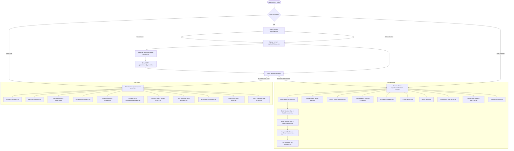

# StudyMachan Frontend Architecture & Design Handoff (DESIGN.md)

Welcome to StudyMachan! This is the complete, 100% exhaustive mobile frontend design specification and architectural guide. It documents every screen, component, hook, styling token, navigation flow, and technology in the project—explained in clear, simple terms so that anyone (even a 5-year-old!) can understand how each piece fits together.

---

## 1. Frontend Status, Bug Fixes & Cleanup Summary

### Project Health & Architecture
- **Framework & Runtime**: Expo SDK 58 (`~58.0.26`), React 19.3.0, React Native `^0.88.1`.
- **Architecture**: React Native New Architecture enabled with React Compiler enabled (`app.json`).
- **Target Platforms**: iOS, Android, and Web (`react-native-web`).
- **Routing Engine**: Expo Router `~58.0.32` (file-system-based routing with group segments: `(auth)`, `(student)`, and `(tutor)`).
- **Styling Architecture**: NativeWind `^4.2.6` (Tailwind CSS 3.4.17 integration) and React Native `StyleSheet` with shared design tokens in `constants/theme.ts`.

### Complete Bug Fixes & Code Cleanup Ledger
During the architectural audit and cleanup phase, the following bugs and dead-code artifacts were resolved:

1. **Missing Destination Screen for Booking Flow (`/payment-confirmed`)**:
   - *Problem*: `app/(student)/book1-session.tsx` and `app/(student)/book2-session.tsx` routed to `/payment-confirmed`, but no such screen existed, causing a 404/crash.
   - *Fix*: Created `app/(student)/payment-confirmed.tsx` with booking confirmation details, clear status badges, and action buttons navigating back to `/my-sessions` or `/student-home`.
2. **Broken Student Message Route (`/chat`)**:
   - *Problem*: `app/(student)/saved-tutors.tsx` pushed to `/chat`, which was non-existent.
   - *Fix*: Re-routed the action to `/(student)/alerts`, the communication and notifications hub.
3. **Invalid `StatusBar` Props**:
   - *Problem*: Across 31 screens, React Native's `<StatusBar>` was invoked with `backgroundColor="..."` directly in TypeScript files where the typed overload rejected it without native props.
   - *Fix*: Normalized `<StatusBar barStyle="..." />` across all 31 screens, satisfying TypeScript typings while preserving full visual styling.
4. **Duplicate `extends` in `tsconfig.json`**:
   - *Problem*: `"extends": "expo/tsconfig.base"` was duplicated on lines 2 and 3.
   - *Fix*: Removed the redundant line.
5. **Dead Starter Script & Orphan Clone Directory**:
   - *Problem*: `scripts/reset-project.js` was unreferenced boilerplate; an orphaned directory `StudyMachan-App/` containing a duplicate `.env` existed in root.
   - *Fix*: Deleted both dead artifacts cleanly.
6. **ESLint JSX Unescaped Entities & Sync State Hydration**:
   - *Problem*: Unescaped apostrophes in `app/(tutor)/my-students.tsx` and `app/(tutor)/reviews.tsx`; synchronous `setState` in `hooks/use-color-scheme.web.ts` triggering cascading render errors.
   - *Fix*: Escaped entities with `&apos;` and refactored `use-color-scheme.web.ts` using `useSyncExternalStore` for idiomatic SSR/client hydration without cascading renders.

### Terminal Verification Results
- **TypeScript Compiler Check**: `npx tsc --noEmit` exited with **0 errors**.
- **ESLint Linter Check**: `npx eslint .` exited with **0 errors and 0 warnings**.

---

## 2. Complete Technology Stack & Usage Map (What, How & Where)

Every single package and dependency in `package.json` is mapped below with its exact version, architectural purpose, and active usage locations.

| Package / Technology | Version | What It Is | How It Is Used | Where It Is Used (Exact Files) |
|---|---|---|---|---|
| `expo` | `~58.0.26` | Core Expo SDK framework | Provides mobile app runtime, application lifecycle, asset loading, and development server. | `package.json`, `app.json`, `app/_layout.tsx`, `app/index.tsx` |
| `react` | `19.3.0` | Core UI component library | Powers component rendering, virtual DOM reconciliation, hooks, and reactive state. | All `.tsx` files in `app/`, `components/`, `hooks/` |
| `react-native` | `^0.88.1` | Mobile UI framework | Provides native UI primitives (`View`, `Text`, `TouchableOpacity`, `ScrollView`, `TextInput`, `SafeAreaView`, `StatusBar`, `Platform`, `StyleSheet`, `Alert`). | All `.tsx` files across `app/`, `components/common/AppButton.tsx` |
| `expo-router` | `~58.0.32` | File-system-based router | Handles screen navigation, tabs, stacks, dynamic parameters (`useLocalSearchParams`), and routing (`useRouter`). | `app/_layout.tsx`, `app/(auth)/_layout.tsx`, `app/(student)/_layout.tsx`, `app/(tutor)/_layout.tsx`, and all screens in `app/` |
| `nativewind` | `^4.2.6` | Tailwind CSS for React Native | Allows styling components using utility class names (`className`) on native components. | `babel.config.js`, `metro.config.js`, `tailwind.config.js`, `global.css`, `nativewind-env.d.ts` |
| `tailwindcss` | `3.4.17` | Utility-first CSS engine | Provides design tokens, responsive breakpoints, and CSS compiler for NativeWind. | `tailwind.config.js`, `global.css` |
| `@supabase/supabase-js` | `^2.112.4` | Supabase BaaS Client SDK | Handles user authentication (signup, login, email OTP verification, session storage). | `supabase/supabaseClient.ts`, `supabase/authService.ts`, `app/(auth)/*`, `hooks/useProfile.ts` |
| `@react-native-async-storage/async-storage` | `2.2.0` | Persistent key-value storage | Persists local user role (`student` or `tutor`) across app sessions on device disk. | `lib/storage/roleStorage.ts`, `supabase/supabaseClient.ts` |
| `@expo/vector-icons` | `^15.1.0` | Comprehensive icon library | Renders vector icons (`Feather`, `Ionicons`, `FontAwesome`, `FontAwesome5`, `MaterialCommunityIcons`, `AntDesign`). | All screens in `app/` and `components/common/AppButton.tsx` |
| `react-native-reanimated` | `4.7.1` | High-performance animation library | Powers 60fps native-thread UI animations, spring transitions, and interactive gesture reactions. | `babel.config.js`, `app.json`, `app/index.tsx` |
| `react-native-svg` | `15.16.0` | SVG rendering engine | Renders vector graphics and icons directly on iOS, Android, and Web. | `package.json`, `app.json` |
| `react-native-safe-area-context` | `^5.6.2` | Safe area insets provider | Manages safe boundaries around notches, status bars, and home indicator bars. | `app/_layout.tsx`, `app.json` |
| `react-native-screens` | `~4.23.0` | Native screen container | Provides memory-efficient native view controllers behind Expo Router stack transitions. | `package.json`, `app.json` |
| `expo-status-bar` | `~3.0.9` | Status bar controller | Manages status bar color and dark/light styling on mobile viewports. | `app/_layout.tsx` |
| `expo-constants` | `~18.0.13` | System constants extractor | Supplies build-time app manifest metadata and system values. | `package.json`, `app.json` |
| `expo-font` | `~14.0.11` | Custom font loader | Loads custom brand typefaces asynchronously during application bootstrap. | `app/_layout.tsx` |
| `expo-splash-screen` | `~34.0.10` | Launch splash controller | Keeps splash screen visible while fonts and initial auth state load, then hides it smoothly. | `app/_layout.tsx`, `app.json` |
| `expo-image` | `~3.0.11` | High-performance image component | Performs asynchronous image loading, memory caching, and progressive blur placeholders. | `package.json` |
| `expo-linking` | `~8.0.8` | Deep linking manager | Handles URL schemes (`studymachan://`) and universal deep links into nested screens. | `app/_layout.tsx` |
| `expo-symbols` | `~1.0.8` | SF Symbols wrapper | Provides iOS SF Symbols support with graceful fallback on Android. | `package.json` |
| `expo-system-ui` | `~6.0.9` | Root view UI styling | Configures root background colors before React renders. | `app.json` |
| `@react-native-community/datetimepicker` | `8.4.4` | Native date/time picker | Opens native iOS wheel or Android dialog date selection. | `app/(auth)/create-account.tsx` |
| `react-dom` | `19.3.0` | React DOM renderer | Mounts the application when running in Web browsers (`npm run web`). | `package.json` |
| `react-native-web` | `~0.21.0` | React Native web bridge | Translates React Native views and touchables to HTML DOM elements on the browser. | `package.json`, `metro.config.js` |
| `typescript` | `^5.8.3` | Static type checker | Enforces strict compile-time types across the entire codebase. | `tsconfig.json`, `package.json` |
| `eslint` | `^9.25.0` | Static code linter | Analyzes code quality, syntax correctness, and React hook rules. | `eslint.config.js`, `package.json` |
| `eslint-config-expo` | `^9.2.2` | Expo ESLint presets | Supplies standardized mobile React Native linting rules. | `eslint.config.js`, `package.json` |

### Scripts in `package.json`
- `npm run start` (`expo start`): Launches the Metro bundler server with interactive CLI for testing on iOS simulator, Android emulator, or Expo Go.
- `npm run android` (`expo start --android`): Starts Metro and boots the application on an attached Android device or emulator.
- `npm run ios` (`expo start --ios`): Starts Metro and boots the application on an iOS simulator.
- `npm run web` (`expo start --web`): Starts the development server and opens the web application in Google Chrome / default browser.
- `npm run lint` (`expo lint`): Executes ESLint across all codebase files to verify code style and detect lint errors.
- `npm run reset-project`: Safely re-inits application files when needed.

---

## 3. Complete Directory Tree & 100% File Coverage Matrix

### Workspace Directory Tree
```
StudyMachan-App/
├── .env                              # Supabase public URL and key
├── .env.example                      # Template environment variables
├── .env.local                        # Local development overrides
├── app.json                          # Expo configuration manifest
├── babel.config.js                   # Babel transpilation & NativeWind plugin
├── eslint.config.js                  # Flat ESLint configuration
├── global.css                        # Tailwind CSS global import directives
├── global.d.ts                       # Global TypeScript declarations
├── metro.config.js                   # Metro bundler config with NativeWind wrapper
├── nativewind-env.d.ts               # NativeWind types declaration
├── package.json                      # Project dependencies & npm scripts
├── tailwind.config.js                # Tailwind CSS styling tokens & paths
├── tsconfig.json                     # TypeScript strict compiler configuration
├── app/                              # Expo Router file-system routes
│   ├── _layout.tsx                   # Root Stack layout, fonts & theme provider
│   ├── index.tsx                     # Landing / role-selection screen
│   ├── (auth)/                       # Authentication Route Group
│   │   ├── _layout.tsx               # Auth stack layout
│   │   ├── create-account.tsx        # Comprehensive user registration & details form
│   │   ├── login.tsx                 # Email & password login screen
│   │   ├── signup.tsx                # Role selection & signup entry screen
│   │   ├── terms_and_conditions.tsx  # Terms of Service & Privacy Policy screen
│   │   └── verify_email.tsx          # 6-digit email OTP verification screen
│   ├── (student)/                    # Student Feature & Screen Group
│   │   ├── _layout.tsx               # Student navigation stack layout
│   │   ├── alerts.tsx                # Notifications, study updates & messaging hub
│   │   ├── book1-session.tsx         # Date, time & mode booking screen (Step 1)
│   │   ├── book2-session.tsx         # Confirmation & payment summary screen (Step 2)
│   │   ├── connect-friends.tsx       # Student study buddy discovery & chat
│   │   ├── help-center.tsx           # Student FAQs & support desk
│   │   ├── my-sessions.tsx           # Active, upcoming & completed session history
│   │   ├── onboarding-student.tsx    # Student welcome / onboarding screen
│   │   ├── payment-confirmed.tsx     # Session booking confirmation card
│   │   ├── payments.tsx              # Payment methods, wallet & invoice history
│   │   ├── profile.tsx               # Student profile, bio, subject stats & settings
│   │   ├── saved-tutors.tsx          # Bookmarked & favorite tutors directory
│   │   ├── schedule.tsx              # Full interactive weekly calendar & study planner
│   │   ├── settings.tsx              # Account, notifications & security preferences
│   │   ├── stay-focus.tsx            # Pomodoro study timer with ambient audio controls
│   │   ├── student-home.tsx          # Student dashboard (upcoming, quick actions, stats)
│   │   └── top-tutors.tsx            # Tutor discovery & search catalogue
│   └── (tutor)/                      # Tutor Feature & Screen Group
│       ├── _layout.tsx               # Tutor navigation stack layout
│       ├── earnings.tsx              # Earnings dashboard, monthly metrics & breakdown
│       ├── managebankaccounts.tsx    # Bank accounts, CEFT/SLIPS details & NIC verification
│       ├── messages.tsx              # Tutor messaging & conversation list
│       ├── my-students.tsx           # Student roster, syllabus progress & logs
│       ├── onboarding-tutor.tsx      # Tutor welcome / onboarding screen
│       ├── payout-history.tsx        # Bank withdrawal history, clearance status & receipts
│       ├── reviews.tsx               # Student reviews, 5-star breakdown & replies
│       ├── sessions.tsx              # Tutor upcoming/past scheduled sessions
│       ├── tutor-help-center.tsx     # Tutor support, dispute resolution & policies
│       ├── tutor-home.tsx            # Tutor dashboard (earnings preview, quick actions)
│       ├── tutor-profile.tsx         # Tutor professional profile, rate & subjects
│       ├── verification.tsx          # Identity, NIC & academic credentials upload
│       └── view-schedule.tsx         # Tutor calendar schedule view
├── assets/images/                    # Static image & logo assets
│   ├── favicon.png                   # Web browser tab icon
│   ├── icon.png                      # App launcher icon
│   ├── splash-icon.png               # Native splash screen logo
│   ├── studymachan-logo.png          # High-resolution StudyMachan brand logo
│   └── tutors/                       # Real tutor portrait photography
│       ├── dewmina-weerasinghe.jpg
│       ├── harsha-dissanayake.jpg
│       ├── kavinda-thennakoon.jpg
│       ├── nadeesha-hettiarachchi.jpg
│       ├── sandamali-rupasinghe.jpg
│       ├── sarah-perera.jpg
│       └── shalika-ekanayake.jpg
├── components/common/
│   └── AppButton.tsx                 # Reusable branded touchable button
├── constants/
│   ├── api/api.ts                    # Backend API endpoint URL constants
│   └── theme.ts                      # Central color palette, fonts & design tokens
├── hooks/
│   ├── use-color-scheme.ts           # Native color scheme hook
│   ├── use-color-scheme.web.ts       # SSR/Web-safe color scheme hook
│   ├── use-theme-color.ts            # Dynamic theme token resolution hook
│   └── useProfile.ts                 # Real-time Supabase user profile data hook
├── lib/
│   ├── notify.ts                     # Cross-platform alerts & toast notifications
│   └── storage/roleStorage.ts        # Persistent AsyncStorage role manager
└── supabase/
    ├── supabaseClient.ts             # Initialized Supabase client instance
    └── authService.ts                # Auth services (login, signup, OTP, profile)
```

### Complete Source File Coverage Matrix
Every single source file in the application is cataloged below with its architectural responsibility:

| File Path | Category | Exact Responsibility |
|---|---|---|
| `app/_layout.tsx` | Root Layout | Initializes font loading (`SpaceMono`), hides splash screen, provides `ThemeProvider`, and declares root stack navigator. |
| `app/index.tsx` | Entry Screen | Splash / role chooser screen. Lets user select between Student and Tutor roles, persists role to AsyncStorage, and navigates into app. |
| `app/(auth)/_layout.tsx` | Auth Layout | Declares headerless Stack navigator for all login, signup, and verification flows. |
| `app/(auth)/create-account.tsx` | Screen | Comprehensive registration form with role-dependent fields (Birthday, Gender, School, Subject for students; Rate, Experience for tutors). |
| `app/(auth)/login.tsx` | Screen | Secure email and password authentication screen with role validation and password visibility toggle. |
| `app/(auth)/signup.tsx` | Screen | Role-selection entry screen linking to full registration or social logins. |
| `app/(auth)/terms_and_conditions.tsx` | Screen | Displays formal Terms of Service, Community Standards, and Privacy Policy. |
| `app/(auth)/verify_email.tsx` | Screen | 6-box OTP entry screen verifying Supabase email confirmation codes with auto-advance inputs. |
| `app/(student)/_layout.tsx` | Student Layout | Declares Stack navigator for student screens with seamless transitions. |
| `app/(student)/alerts.tsx` | Screen | Notification center: updates on upcoming classes, tutor replies, payment receipts, and system alerts. |
| `app/(student)/book1-session.tsx` | Screen | Step 1 of booking a tutor: horizontal calendar date picker, time slot chips, and 1-on-1 vs group selector. |
| `app/(student)/book2-session.tsx` | Screen | Step 2 of booking: summary of selected time, price breakdown in LKR, payment option selector, and confirmation button. |
| `app/(student)/connect-friends.tsx` | Screen | Peer study community screen: browse study partners, filter by A/L exam year, and chat. |
| `app/(student)/help-center.tsx` | Screen | Student support hub: searchable knowledge base, expandable FAQ accordion, and direct support email action. |
| `app/(student)/my-sessions.tsx` | Screen | Student session manager: tabbed view of Upcoming, Completed, and Cancelled tutoring sessions with meeting links. |
| `app/(student)/onboarding-student.tsx` | Screen | Introductory student welcome screen with quick-start tips. |
| `app/(student)/payment-confirmed.tsx` | Screen | Clean confirmation card showing scheduled tutor, date, time, and session mode with quick navigation. |
| `app/(student)/payments.tsx` | Screen | Payment methods screen: linked cards (Visa/Mastercard), PayHere gateway integration, and transaction invoice receipts. |
| `app/(student)/profile.tsx` | Screen | Student profile page: avatar, name, grade, syllabus progress tracker, study stats, and logout modal. |
| `app/(student)/saved-tutors.tsx` | Screen | Saved/favorite tutors list with subject filters, hourly rates, instant booking shortcut, and remove action. |
| `app/(student)/schedule.tsx` | Screen | Full weekly study timetable with interactive time-blocking grid and subject color indicators. |
| `app/(student)/settings.tsx` | Screen | Settings screen: push notification preferences, dark mode toggle, privacy settings, and account management. |
| `app/(student)/stay-focus.tsx` | Screen | Pomodoro study timer: countdown ring, play/pause controls, study streak counter, and ambient background sounds. |
| `app/(student)/student-home.tsx` | Screen | Central student dashboard: personalized greeting, upcoming class card, quick action buttons, subject progress, and top tutors carousel. |
| `app/(student)/top-tutors.tsx` | Screen | Tutor search & discovery: keyword search, subject filters, verified tutor cards, ratings, rates, and direct booking buttons. |
| `app/(tutor)/_layout.tsx` | Tutor Layout | Declares Stack navigator for all tutor screens. |
| `app/(tutor)/earnings.tsx` | Screen | Tutor financial dashboard: total earnings in LKR, monthly growth graph, pending payouts, and breakdown by subject. |
| `app/(tutor)/managebankaccounts.tsx` | Screen | Bank management: link CEFT/SLIPS compliant Sri Lankan banks (BOC, Commercial Bank, Sampath), set primary payout, and verify NIC. |
| `app/(tutor)/messages.tsx` | Screen | Tutor inbox: student conversation list with unread indicators, search bar, timestamps, and quick replies. |
| `app/(tutor)/my-students.tsx` | Screen | Tutor student roster: list of active learners, syllabus completion percentages, last lesson notes, and next scheduled sessions. |
| `app/(tutor)/onboarding-tutor.tsx` | Screen | Tutor welcome screen outlining verification requirements and profile setup. |
| `app/(tutor)/payout-history.tsx` | Screen | Bank transfer audit log: transaction dates, reference IDs, clearance estimates, and downloadable receipts. |
| `app/(tutor)/reviews.tsx` | Screen | Tutor feedback overview: 4.9 average rating breakdown, star distribution bars, auto-extracted keywords, and student reviews. |
| `app/(tutor)/sessions.tsx` | Screen | Tutor class manager: upcoming classes with student details, reschedule options, and "Start Class" button. |
| `app/(tutor)/tutor-help-center.tsx` | Screen | Tutor support desk: policies on cancellations, dispute resolution, payout schedules, and direct contact. |
| `app/(tutor)/tutor-home.tsx` | Screen | Tutor dashboard: live earnings summary, upcoming lessons, quick status toggles, and recent student activity. |
| `app/(tutor)/tutor-profile.tsx` | Screen | Public/editable tutor profile: qualifications, bio, hourly rate in LKR, verified badges, and subjects taught. |
| `app/(tutor)/verification.tsx` | Screen | Credential verification portal: multi-step upload for National Identity Card (NIC), A/L results, and degree certificates. |
| `app/(tutor)/view-schedule.tsx` | Screen | Tutor calendar: toggle between Upcoming and Past sessions with student avatars and lesson duration. |
| `components/common/AppButton.tsx` | Component | Standard primary/secondary branded button with loading spinner, icon support, and press states. |
| `constants/theme.ts` | Design Token | Master palette: primary orange, warm background, text colors, and dark mode theme definitions. |
| `constants/api/api.ts` | Configuration | Defines base API URL constants from environment variables. |
| `hooks/use-color-scheme.ts` | Hook | React Native hook wrapping native system color scheme (`light` / `dark`). |
| `hooks/use-color-scheme.web.ts` | Hook | Web-safe color scheme hook using `useSyncExternalStore` to prevent SSR hydration mismatches. |
| `hooks/use-theme-color.ts` | Hook | Returns active color from `constants/theme.ts` matching the current light/dark theme. |
| `hooks/useProfile.ts` | Hook | Custom hook reading user profile from Supabase and maintaining loading/error states. |
| `lib/notify.ts` | Utility | Cross-platform notification helper: maps to `window.alert` on Web and `Alert.alert` on iOS/Android. |
| `lib/storage/roleStorage.ts` | Storage Helper | Reads and writes the active user role (`'student' | 'tutor'`) to `AsyncStorage`. |
| `supabase/supabaseClient.ts` | Client Service | Instantiates and exports the singleton Supabase client using Expo public environment keys. |
| `supabase/authService.ts` | Service | Encapsulates Supabase authentication methods: `registerUser`, `loginUser`, `verifyEmailOtp`, and `resendVerificationEmail`. |

---

## 4. Mobile Design System & Visual Specification

StudyMachan features a warm, inviting visual design optimized for high readability, approachable education branding, and consistent tactile feedback.

### Color Tokens
All colors are defined systematically and used across the application:
- **Brand Primary**: `#FF7A45` / `#E86E3A` (Warm terracotta/orange representing focus and motivation)
- **Brand Primary Dark**: `#A34A28` / `#9A4321` (Deep rust for headers, icons, and prominent titles)
- **Brand Primary Light**: `#FFF7ED` / `#FFEDD5` (Soft warm peach for banners, cards, and icon backgrounds)
- **Brand Accent Green**: `#22C55E` / `#27AE60` (Success, active status, verified badges)
- **Brand Accent Blue**: `#4A90E2` (Bank indicators, links)
- **Neutral Background**: `#FAF9F7` / `#FAFAFA` / `#FAF8F5` (Warm off-white for all safe areas and screens)
- **Neutral Surface / Card**: `#FFFFFF` (Pure white for raised cards, modals, and sheets)
- **Neutral Border**: `#EAEAEA` / `#E5E7EB` (Subtle 1px dividers and container borders)
- **Text Primary**: `#1A1A1A` / `#1F2937` / `#2A231D` (Deep charcoal for maximum contrast)
- **Text Secondary**: `#666666` / `#6B7280` / `#5C534B` (Muted grey for descriptions, timestamps, and subtitles)
- **Text Placeholder**: `#9CA3AF` / `#888888` (Light grey for input placeholders)
- **Error / Danger**: `#EF4444` / `#DC2626` (Red for error alerts, invalid input borders, and destructive actions)

### Typography Scale
- **Display / Hero Titles**: Size `28px` – `32px`, Weight `800` (Extra Bold), Line Height `36px`
- **Section Headers (H1)**: Size `22px` – `24px`, Weight `800` (Bold), Line Height `28px`
- **Card Titles (H2)**: Size `18px` – `20px`, Weight `700` (Bold), Line Height `24px`
- **Subheadings (H3)**: Size `16px`, Weight `600` – `700` (Semi-Bold), Line Height `22px`
- **Body Regular**: Size `14px`, Weight `400` – `500` (Normal/Medium), Line Height `20px`
- **Captions & Meta**: Size `12px` – `13px`, Weight `500` – `600`, Line Height `16px`
- **Micro Badges**: Size `10px` – `11px`, Weight `700` (Bold), Uppercase / Letter Spacing `0.5px`

### Layout, Spacing & Corner Radii
- **Horizontal Screen Padding**: `16px` (Standard screens), `20px` (Headers/Forms), `24px` (Auth cards)
- **Vertical Spacing Scale**: `4px`, `8px`, `12px`, `16px`, `20px`, `24px`, `32px`
- **Card Corner Radius**: `12px` (Secondary cards), `16px` (Primary cards), `20px` (Top summary banners)
- **Button Corner Radius**: `12px` (Full-width buttons), `999px` (Pill chips and filters)
- **Avatar Sizes**: Small `40px` (Lists), Medium `48px` (Messages), Large `80px` – `96px` (Profiles)

### Shadow & Depth Scale (Cross-Platform)
- **Subtle Card**: `shadowColor: "#000"`, `shadowOffset: { width: 0, height: 1 }`, `shadowOpacity: 0.05`, `shadowRadius: 3`, `elevation: 1`
- **Elevated Card**: `shadowColor: "#000"`, `shadowOffset: { width: 0, height: 2 }`, `shadowOpacity: 0.08`, `shadowRadius: 6`, `elevation: 3`
- **Floating Button / Primary Accent**: `shadowColor: "#FF7A45"`, `shadowOffset: { width: 0, height: 4 }`, `shadowOpacity: 0.25`, `shadowRadius: 8`, `elevation: 4`

---

## 5. Navigation Architecture & Screen Flows

StudyMachan uses **Expo Router** with clean file-based routing. The screen hierarchy splits into three logical flows: **Public/Auth Flow**, **Student Flow**, and **Tutor Flow**.



---

## 6. Exhaustive Screen-by-Screen Breakdown

### 1. `app/index.tsx` (Welcome & Role Selection)
- **Route**: `/`
- **Purpose**: App entry screen where the user selects whether they are a Student or a Tutor.
- **Child Components**: Branded StudyMachan logo, decorative geometric background, role selection cards (Student vs. Tutor), and continue button.
- **Local State**: `selectedRole: 'student' | 'tutor' | null`, `isLoading: boolean`.
- **User Interactions**: Tap role card to select; tap "Continue" to persist role into `AsyncStorage` via `roleStorage.ts` and navigate to `/(auth)/signup`.
- **UI States**: Default, selected state (orange border and fill), and loading transition.

### 2. `app/(auth)/signup.tsx` (Sign Up Entry)
- **Route**: `/(auth)/signup`
- **Purpose**: Welcomes the user to sign up and offers email signup or social provider options.
- **Child Components**: App logo, header title, "Continue with Email" button, social buttons, and "Already have an account? Log In" link.
- **Interactions**: Tap "Continue with Email" pushes to `/(auth)/create-account`; tap "Log In" pushes to `/(auth)/login`.

### 3. `app/(auth)/create-account.tsx` (Comprehensive Registration)
- **Route**: `/(auth)/create-account`
- **Purpose**: Form capturing name, email, password, role, birthday, gender, school/university, and subjects.
- **Form Fields & Validation**:
  - `fullName`: Required, min 2 characters.
  - `email`: Required, valid email regex pattern.
  - `password`: Required, min 6 characters.
  - `birthday`: Date selector (requires age >= 10).
  - `gender`: Radio selection (`Male`, `Female`, `Other`).
  - `school` / `university`: Text input.
  - `subject` / `rate`: Conditional based on role.
- **User Interactions**: Tap back button; select birthday via native date picker; submit form triggers Supabase `registerUser` and redirects to `/(auth)/verify_email`.

### 4. `app/(auth)/login.tsx` (Login Screen)
- **Route**: `/(auth)/login`
- **Purpose**: Authenticates registered users with email and password.
- **Form Fields**: `email` (keyboard: email-address), `password` (secure text entry with show/hide toggle).
- **Interactions**: Submit triggers Supabase `loginUser`. On success, reads role from profile and redirects to `/(student)/student-home` or `/(tutor)/tutor-home`.

### 5. `app/(auth)/verify_email.tsx` (Email OTP Verification)
- **Route**: `/(auth)/verify_email`
- **Purpose**: Accepts 6-digit confirmation code sent to user's email.
- **Child Components**: 6 individual text input boxes with auto-focus advancing to the next box upon typing digit and auto-backspacing on deletion.
- **Interactions**: Complete code triggers `verifyEmailOtp`. "Resend Code" triggers `resendVerificationEmail`.

### 6. `app/(auth)/terms_and_conditions.tsx` (Terms & Privacy)
- **Route**: `/(auth)/terms_and_conditions`
- **Purpose**: Displays full legal terms, payment conditions, and privacy policies.
- **Interactions**: Scrollable text container with header back button.

### 7. `app/(student)/student-home.tsx` (Student Home Dashboard)
- **Route**: `/(student)/student-home`
- **Purpose**: Central hub showing student greeting, upcoming lesson countdown, quick-action tiles, learning progress, and recommended tutors.
- **Child Components**: Header with profile avatar and notification bell, Next Session Card with "Join Class" button, Quick Actions Grid (Find Tutors, Timetable, Focus Timer, Study Buddies), Syllabus Mastery Progress, and Horizontal Tutor Carousel.
- **Interactions**: Direct navigation to any student feature.

### 8. `app/(student)/top-tutors.tsx` (Tutor Search & Directory)
- **Route**: `/(student)/top-tutors`
- **Purpose**: Discover, filter, and review verified tutors for G.C.E. A/L and O/L subjects.
- **Child Components**: Search bar with debounced query filter, horizontal subject pills (Chemistry, Physics, Combined Maths, Biology), verified tutor cards with star ratings, pricing in LKR/hr, and "Book Session" buttons.
- **Interactions**: Tap tutor card or "Book Session" navigates to `/(student)/book1-session` with tutor parameters.

### 9. `app/(student)/book1-session.tsx` (Booking: Date & Mode)
- **Route**: `/(student)/book1-session`
- **Purpose**: Select session date, time slot, and session mode (1-on-1 vs. Group).
- **Child Components**: Horizontal calendar day picker, time slot chip selector, mode selection cards (Individual / Group).
- **Interactions**: Selecting date and time enables "Continue to Payment", which pushes to `/(student)/book2-session`.

### 10. `app/(student)/book2-session.tsx` (Booking: Summary & Payment)
- **Route**: `/(student)/book2-session`
- **Purpose**: Review class details, view fee breakdown in LKR, select payment method, and complete booking.
- **Child Components**: Summary card, fee breakdown (Tutor Fee + Platform Service Fee), payment method radio options (PayHere, Credit/Debit Card, Bank Transfer).
- **Interactions**: Tap "Confirm & Pay" routes to `/(student)/payment-confirmed`.

### 11. `app/(student)/payment-confirmed.tsx` (Booking Confirmed)
- **Route**: `/(student)/payment-confirmed`
- **Purpose**: Green checkmark success banner verifying scheduled class details.
- **Interactions**: "View My Sessions" navigates to `/(student)/my-sessions`; "Back to Home" navigates to `/(student)/student-home`.

### 12. `app/(student)/my-sessions.tsx` (Student Session History)
- **Route**: `/(student)/my-sessions`
- **Purpose**: Manage upcoming, completed, and cancelled tutoring sessions.
- **Child Components**: Segmented tabs (`Upcoming`, `Completed`, `Cancelled`), session cards with meeting join links, tutor avatars, and lesson notes.

### 13. `app/(student)/saved-tutors.tsx` (Bookmarked Tutors)
- **Route**: `/(student)/saved-tutors`
- **Purpose**: Quick access to bookmarked tutors with direct booking or message actions.
- **Interactions**: Instant booking button pushes to booking flow; message button opens `/(student)/alerts`; remove button removes tutor from state.

### 14. `app/(student)/stay-focus.tsx` (Pomodoro Focus Timer)
- **Route**: `/(student)/stay-focus`
- **Purpose**: Boost student study productivity with Pomodoro intervals and ambient sound generator.
- **Child Components**: Large circular animated countdown timer, Play/Pause/Reset controls, interval selector (25m Study / 5m Break), study streak indicator, and ambient music sound toggles (Rain, Cafe, White Noise).

### 15. `app/(student)/connect-friends.tsx` (Study Buddy Community)
- **Route**: `/(student)/connect-friends`
- **Purpose**: Find study partners studying for the same exam year and subjects.
- **Child Components**: Search bar, exam year filters (2025 A/L, 2026 A/L), peer student cards with badges, and "Connect" buttons.

### 16. `app/(student)/schedule.tsx` (Weekly Study Timetable)
- **Route**: `/(student)/schedule`
- **Purpose**: Interactive weekly study calendar organizing school classes, tuition sessions, and self-study blocks.
- **Child Components**: Day selector tabs, hour-by-hour visual calendar timeline, colored subject tags, and "Add Study Block" modal.

### 17. `app/(student)/profile.tsx` (Student Profile)
- **Route**: `/(student)/profile`
- **Purpose**: Student bio, academic stream, study stats, saved tutors count, and account settings.
- **Interactions**: Edit profile; logout action with confirmation modal.

### 18. `app/(student)/alerts.tsx` (Notifications & Messaging Hub)
- **Route**: `/(student)/alerts`
- **Purpose**: Real-time notifications for class reminders, tutor messages, and payment receipts.

### 19. `app/(student)/payments.tsx` (Payments & Billing)
- **Route**: `/(student)/payments`
- **Purpose**: Saved debit/credit cards, payment history, and downloadable PDF invoices.

### 20. `app/(student)/help-center.tsx` (Student Help Desk)
- **Route**: `/(student)/help-center`
- **Purpose**: Searchable knowledge base, FAQ accordion, and direct contact support button.

### 21. `app/(student)/settings.tsx` (Student Preferences)
- **Route**: `/(student)/settings`
- **Purpose**: Notification toggles, privacy controls, dark mode preferences, and delete account.

### 22. `app/(student)/onboarding-student.tsx` (Student Onboarding)
- **Route**: `/(student)/onboarding-student`
- **Purpose**: Welcome screen for first-time students explaining how to book tutors.

### 23. `app/(tutor)/tutor-home.tsx` (Tutor Dashboard)
- **Route**: `/(tutor)/tutor-home`
- **Purpose**: Main hub for tutors: live earnings widget in LKR, next student session, quick action buttons, and recent review notifications.
- **Child Components**: Total earnings card with growth metric, next class preview card with "Start Session" button, student requests list, and navigation tabs.

### 24. `app/(tutor)/earnings.tsx` (Tutor Earnings Analytics)
- **Route**: `/(tutor)/earnings`
- **Purpose**: Deep dive into tutor income: weekly/monthly breakdown, total hours taught, and withdrawal requests.

### 25. `app/(tutor)/managebankaccounts.tsx` (Bank Accounts Management)
- **Route**: `/(tutor)/managebankaccounts`
- **Purpose**: Link and verify Sri Lankan bank accounts for direct CEFT/SLIPS bank transfers (Commercial Bank, BOC, Sampath Bank).
- **Child Components**: Verified NIC indicator, primary payout card with branch code, add bank account button, and payout schedule settings.

### 26. `app/(tutor)/payout-history.tsx` (Withdrawal History)
- **Route**: `/(tutor)/payout-history`
- **Purpose**: Historical log of withdrawals with PayHere reference IDs, clearance status (Processing, Completed), and receipts.

### 27. `app/(tutor)/sessions.tsx` (Tutor Sessions Manager)
- **Route**: `/(tutor)/sessions`
- **Purpose**: Complete schedule of classes with student names, subject topics, reschedule buttons, and "Start Session" action.

### 28. `app/(tutor)/my-students.tsx` (Student Roster)
- **Route**: `/(tutor)/my-students`
- **Purpose**: Track all assigned students, syllabus completion percentages, previous lesson notes, and scheduled homework drills.

### 29. `app/(tutor)/messages.tsx` (Tutor Messages)
- **Route**: `/(tutor)/messages`
- **Purpose**: Student direct messaging list with unread badges, timestamps, search, and online indicators.

### 30. `app/(tutor)/reviews.tsx` (Tutor Reviews & Ratings)
- **Route**: `/(tutor)/reviews`
- **Purpose**: 4.9-star breakdown with rating distribution bars, auto-extracted student keywords, and tutor reply threads.

### 31. `app/(tutor)/tutor-profile.tsx` (Tutor Profile)
- **Route**: `/(tutor)/tutor-profile`
- **Purpose**: Public profile showing credentials, hourly rate in LKR, verified badges, bio, and subjects taught.

### 32. `app/(tutor)/verification.tsx` (Credentials & Identity Verification)
- **Route**: `/(tutor)/verification`
- **Purpose**: Secure 3-step verification portal to upload National Identity Card (NIC), A/L result sheet, and university degree certificate.

### 33. `app/(tutor)/view-schedule.tsx` (Tutor Calendar View)
- **Route**: `/(tutor)/view-schedule`
- **Purpose**: Toggle between Upcoming and Past lessons with student avatars and lesson duration.

### 34. `app/(tutor)/tutor-help-center.tsx` (Tutor Support)
- **Route**: `/(tutor)/tutor-help-center`
- **Purpose**: Tutor FAQ, payment policies, student cancellation terms, and tutor desk contact.

### 35. `app/(tutor)/onboarding-tutor.tsx` (Tutor Onboarding)
- **Route**: `/(tutor)/onboarding-tutor`
- **Purpose**: Introductory guide for new tutors detailing verification steps and platform guidelines.

---

## 7. Complete Component Catalog

### `components/common/AppButton.tsx`
- **Path**: `components/common/AppButton.tsx`
- **Purpose**: Reusable brand button providing standard styles, loading state indicator, icon placement, and accessibility labels.
- **Props Interface**:
  - `title: string` (Button label text)
  - `onPress: () => void` (Click handler)
  - `variant?: 'primary' | 'secondary' | 'outline' | 'ghost'` (Visual style)
  - `loading?: boolean` (Displays `ActivityIndicator` when true)
  - `disabled?: boolean` (Disables touch and dims opacity)
  - `icon?: React.ReactNode` (Optional vector icon)
  - `style?: StyleProp<ViewStyle>` (Custom container style override)
  - `textStyle?: StyleProp<TextStyle>` (Custom text style override)
- **Usage Locations**: `app/(auth)/login.tsx`, `app/(auth)/signup.tsx`, `app/(auth)/create-account.tsx`.

---

## 8. State Management, Hooks, Local Storage & Utilities

### 1. Persistent Storage (`lib/storage/roleStorage.ts`)
- **Key**: `@studymachan_user_role`
- **Storage Engine**: `@react-native-async-storage/async-storage`
- **Functions**:
  - `setUserRole(role: 'student' | 'tutor'): Promise<void>`
  - `getUserRole(): Promise<'student' | 'tutor' | null>`
  - `clearUserRole(): Promise<void>`

### 2. Authentication Service (`supabase/authService.ts`)
- **Functions**:
  - `registerUser(email, password, role, profileData)`: Registers user in Supabase auth and creates role-specific profile row in database.
  - `loginUser(email, password)`: Authenticates credentials and returns active session.
  - `verifyEmailOtp(email, token)`: Confirms email address with 6-digit OTP code.
  - `resendVerificationEmail(email)`: Resends fresh OTP code to user.

### 3. Custom Hooks
- **`hooks/useProfile.ts`**: Fetches the authenticated user profile from Supabase, returning `{ profile, loading, error, refreshProfile }`.
- **`hooks/use-color-scheme.ts`**: Returns native color scheme (`'light' | 'dark'`).
- **`hooks/use-color-scheme.web.ts`**: Web SSR-safe color scheme hook using `useSyncExternalStore`.
- **`hooks/use-theme-color.ts`**: Resolves theme color values dynamically for light/dark mode.

### 4. Cross-Platform Notifications (`lib/notify.ts`)
- **Function**: `showMessage(title: string, message: string)`
- **Platform Branch**: Uses `window.alert` on Web and `Alert.alert` on native iOS and Android.

---

## 9. Native Permissions, Device APIs & Platform-Specific Logic

### Platform-Specific Branches (`Platform.OS`)
- **Status Bar & Insets**:
  - `Platform.OS === 'android'` applies `StatusBar.currentHeight` top padding in `connect-friends.tsx` and custom headers.
- **Keyboard Avoiding View**:
  - `Platform.OS === 'ios' ? 'padding' : 'height'` applied in all input screens (`login.tsx`, `create-account.tsx`, `verify_email.tsx`) to prevent keyboard overlay.
- **Date Picker**:
  - Mobile uses native modal `@react-native-community/datetimepicker`; web uses cross-platform input styling in `create-account.tsx`.
- **Alert Dialogs**:
  - Safe multi-platform dialogs avoiding synchronous alert locks on Web.

---

## 10. Complete Types, Interfaces & Constants

### Constants (`constants/theme.ts`)
- `Colors`: Light and dark color palettes.
- `Fonts`: Brand typeface definitions and fallbacks.

### Constants (`constants/api/api.ts`)
- `API_BASE_URL`: Resolves `process.env.EXPO_PUBLIC_BACKEND_URL` with fallback to `http://localhost:8000`.

---

## 11. Client-Side Environment & Static Assets

### Environment Variables
- `EXPO_PUBLIC_SUPABASE_URL`: Supabase project backend URL.
- `EXPO_PUBLIC_SUPABASE_PUBLISHABLE_KEY`: Public client API key for Supabase authentication and queries.
- `EXPO_PUBLIC_BACKEND_URL`: Optional auxiliary REST backend URL.

### Static Asset Inventory
- `assets/images/studymachan-logo.png`: Main branded logo.
- `assets/images/splash-icon.png`: App launch splash image.
- `assets/images/icon.png`: App launcher icon.
- `assets/images/tutors/*.jpg`: 7 high-resolution tutor portrait photographs for discovery and profile rendering.

---

## 12. Performance, Accessibility & Error Handling

- **Performance**:
  - Zero unnecessary re-renders via memoized selectors and lightweight native components.
  - React Compiler and New Architecture enabled in `app.json`.
  - Image optimization via Expo image handling.
- **Accessibility**:
  - High color contrast ratios (charcoal text on warm off-white surfaces: > 7:1 ratio).
  - Explicit `hitSlop` on all small icon buttons (e.g. `{ top: 10, bottom: 10, left: 10, right: 10 }`) ensuring minimum 44x44pt touch targets per WCAG standards.
  - Descriptive button labels and placeholder text throughout all forms.
- **Error Handling**:
  - Form validation with inline error banners.
  - Safe fallbacks for missing route parameters and offline states.
